<p align="center">
  <picture>
    <source media="(prefers-color-scheme: dark)" srcset="./.github/text-logo.svg">
    
  </picture>
</p>

<p align="center">Show the technologies behind your work in a single SVG.</p>

<p align="center">
  <a href="https://skill-icons-v2.vercel.app/"></a>
  <a href="#icons-list"></a>
</p>

<p align="center">
  
</p>

Skill Icons combines the languages, frameworks, and tools you choose into one image for a portfolio, project page, or documentation site. Use the builder to preview your selection and copy the Markdown, or compose the image URL yourself.

## Contents

- [Specifying icons](#specifying-icons)
- [Themed icons](#themed-icons)
- [Icons per row](#icons-per-row)
- [Centering icons](#centering-icons)
- [Icons list](#icons-list)

## Specifying icons

Set `i` to a comma-separated list of icon IDs in the order you want them to appear. Paste this example into any Markdown document that supports images.

```markdown

```


Full names and shortcuts can share the same URL. For example, `i=javascript,py,k8s` selects JavaScript, Python, and Kubernetes. IDs are case-insensitive. [View all shortcuts](./lib/aliases.json)

## Themed icons

Use `theme=light` or `theme=dark` to choose the background for icons with themed variants. The API uses the light variant when you omit the parameter. Icons with a single design look the same in either theme.

| Light | Dark |
| :--- | :--- |
|  |  |
| `?i=react,node,figma&theme=light` | `?i=react,node,figma&theme=dark` |

## Icons per row

For a narrow sidebar or profile section, use `perline` to set the maximum number of icons per row. The example below wraps six icons into two rows of three. Use any integer from 1 to 50, or omit the parameter to keep the selection on one line.

```markdown

```


## Centering icons

Use the same URL as the source of an HTML image. To center it in a GitHub project description or profile, wrap the image in a centered paragraph.

```html
<p align="center">
  
</p>
```

<p align="center">
  
</p>

## Icons list

Search by name or shortcut in the [interactive library](https://skill-icons-v2.vercel.app/#catalog), or browse the alphabetical index below. Each label is an ID you can use directly in the URL.

| Icon ID | Icon ID | Icon ID | Icon ID |
| :--- | :--- | :--- | :--- |
|  `ableton` | 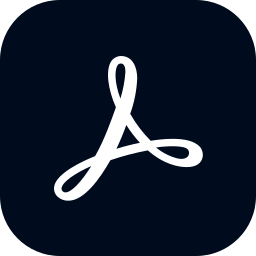 `acrobat` | 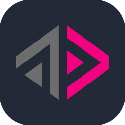 `activitypub` | 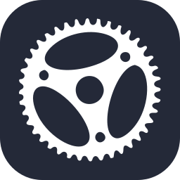 `actix` |
| 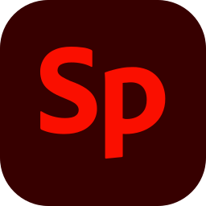 `adobespark` |  `adonis` | 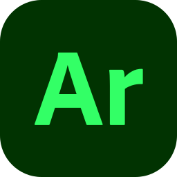 `aero` |  `aftereffects` |
|  `aiscript` | 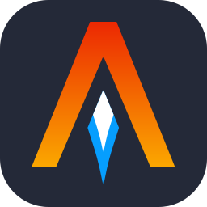 `alacritty` | 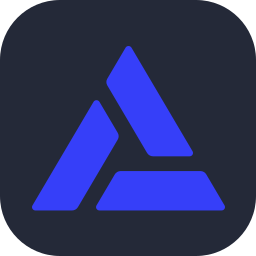 `alchemy` | 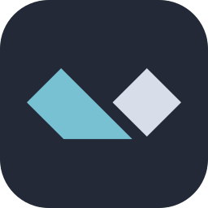 `alpinejs` |
|  `anaconda` |  `android` | 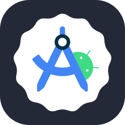 `androidstudio` | 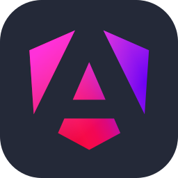 `angular` |
| 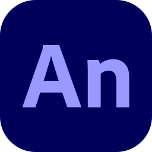 `animate` |  `ansible` |  `anss` | 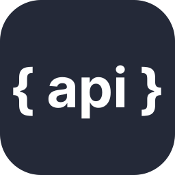 `api` |
| 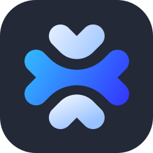 `apidog` |  `apollo` | 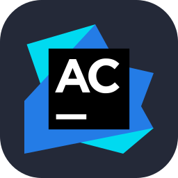 `appcode` | 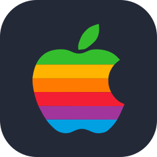 `apple` |
|  `appwrite` | 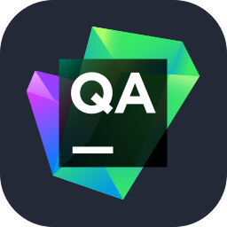 `aqua` | 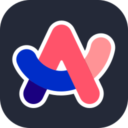 `arcbrowser` | 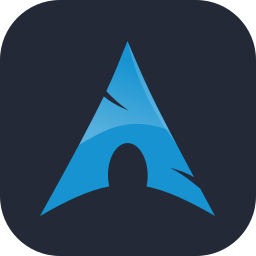 `arch` |
|  `arduino` |  `argocd` | 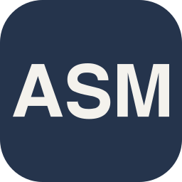 `assembly` |  `astro` |
|  `atom` |  `audition` |  `authjs` | 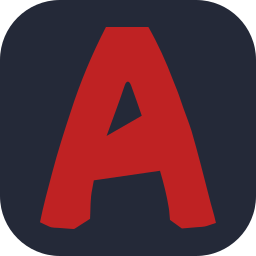 `autocad` |
| 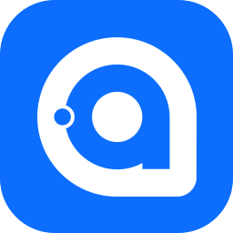 `avaloniaui` |  `aws` |  `azul` | 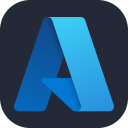 `azure` |
|  `azuredevops` |  `babel` | 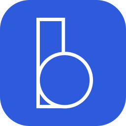 `barbajs` | 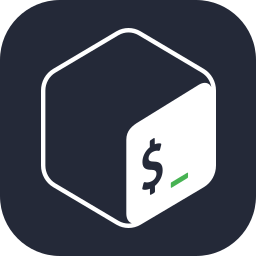 `bash` |
| 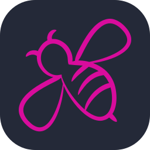 `beeceptor` |  `behance` |  `behat` | 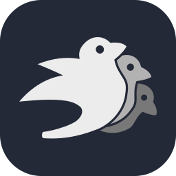 `bevy` |
|  `bigquery` | 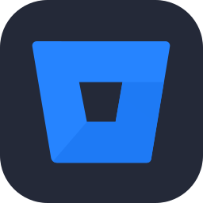 `bitbucket` |  `blazor` | 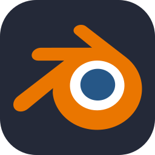 `blender` |
|  `bokeh` |  `bootstrap` |  `brave` |  `breeze` |
| 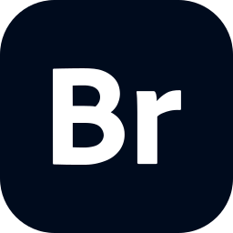 `bridge` | 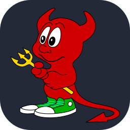 `bsd` |  `btlo` | 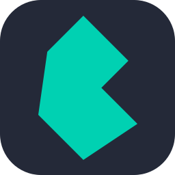 `bulma` |
|  `bun` |  `c` | 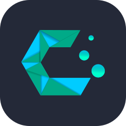 `cachyos` |  `caddy` |
| 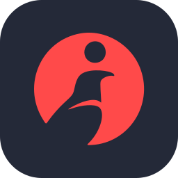 `cairo` |  `canva` |  `capacitor` |  `capture` |
|  `cashier` | 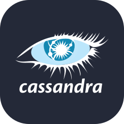 `cassandra` | 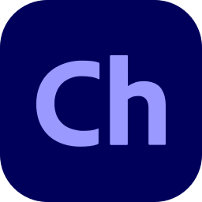 `characteranimator` | 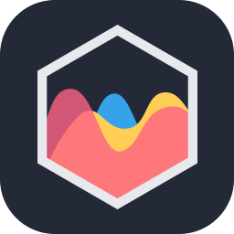 `chartjs` |
|  `chatgpt` |  `chrome` |  `chromium` | 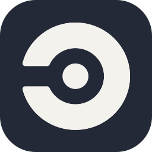 `circleci` |
| 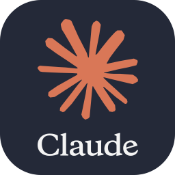 `claude` |  `clerk` | 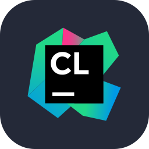 `clion` | 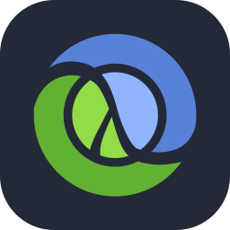 `clojure` |
|  `cloudflare` | 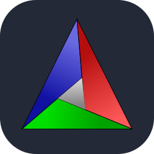 `cmake` | 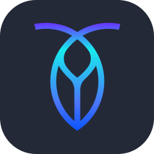 `cockroachdb` | 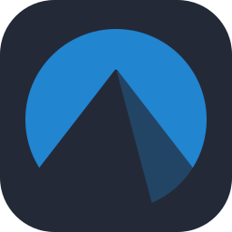 `codeberg` |
|  `codeigniter` | 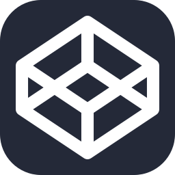 `codepen` |  `coffeescript` |  `commercetools` |
|  `composer` | 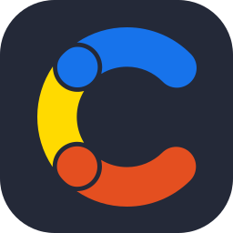 `contentful` |  `cpp` | 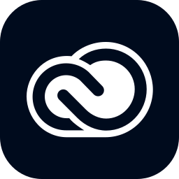 `creativecloud` |
| 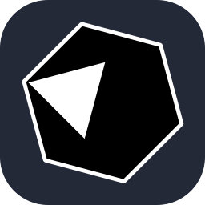 `crystal` |  `cs` | 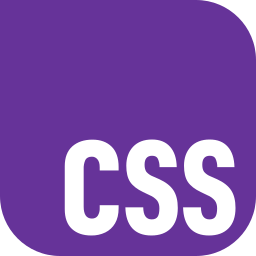 `css` |  `cuda` |
| 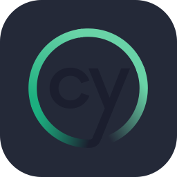 `cypress` |  `d` |  `d3` | 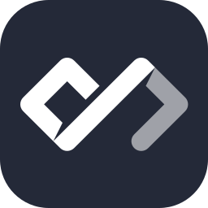 `dailydev` |
|  `daisyui` |  `dart` |  `databricks` |  `datadog` |
|  `datagrip` |  `dataspell` |  `davinci` |  `dbeaver` |
|  `debian` |  `defold` |  `deno` |  `desmos` |
|  `devto` |  `digitalocean` |  `dimension` |  `directus` |
|  `discord` |  `discordbots` |  `discordjs` |  `django` |
|  `docker` |  `docksal` |  `docsify` |  `dotnet` |
|  `dreamweaver` |  `drupal` |  `duckduckgo` |  `dusk` |
|  `dynamodb` |  `echo` |  `eclipse` |  `edge` |
|  `elasticsearch` |  `electron` |  `elementplus` |  `elixir` |
|  `elm` |  `elysia` |  `emacs` |  `ember` |
|  `emotion` |  `envoyer` |  `erlang` |  `excel` |
|  `expo` |  `expressjs` |  `fabric` |  `facebook` |
|  `fastai` |  `fastapi` |  `fediverse` |  `ffmpeg` |
|  `fiber` |  `figma` |  `filament` |  `firebase` |
|  `firefox` |  `flameshot` |  `flask` |  `fleet` |
|  `flutter` |  `flyio` |  `fonts` |  `forge` |
|  `forgejo` |  `forth` |  `fortran` |  `frankenphp` |
|  `fresco` |  `fresh` |  `fuse` |  `gamemakerstudio` |
|  `ganache` |  `gatsby` |  `gcp` |  `gdevelop` |
|  `gemini` |  `gentoo` |  `gherkin` |  `gimp` |
|  `git` |  `gitea` |  `github` |  `githubactions` |
|  `githubcopilot` |  `githubpages` |  `gitkraken` |  `gitlab` |
|  `gleam` |  `gmail` |  `gnome` |  `godot` |
|  `goland` |  `golang` |  `googleanalytics` |  `googleappsscript` |
|  `gradle` |  `grafana` |  `grails` |  `graphql` |
|  `grpc` |  `grunt` |  `gsap` |  `gtk` |
|  `gulp` |  `hadoop` |  `hardhat` |  `haskell` |
|  `haxe` |  `haxeflixel` |  `helix` |  `helm` |
|  `herd` |  `heroku` |  `hibernate` |  `holyc` |
|  `hono` |  `horizon` |  `html` |  `htmx` |
|  `htop` |  `huggingface` |  `hugo` |  `hydrogen` |
|  `hyprland` |  `i3` |  `iced` |  `idea` |
|  `ignite` |  `illustrator` |  `incopy` |  `indesign` |
|  `inertia` |  `infura` |  `inkscape` |  `insomnia` |
|  `instagram` |  `integrations` |  `ipfs` |  `jamovi` |
|  `java` |  `javascript` |  `jekyll` |  `jenkins` |
|  `jest` |  `jetpackcompose` |  `jetstream` |  `jira` |
|  `joomla` |  `jquery` |  `julia` |  `jupyter` |
|  `kafka` |  `kaggle` |  `kakoune` |  `kali` |
|  `karma` |  `kde` |  `keycloak` |  `keydb` |
|  `kibana` |  `kitty` |  `kotlin` |  `ktor` |
|  `kubernetes` |  `langchain` |  `laravel` |  `laravelspark` |
|  `latex` |  `leaflet` |  `leetcode` |  `less` |
|  `libsql` |  `lighthouse` |  `lightning` |  `lightroom` |
|  `lightroomclassic` |  `linkedin` |  `linux` |  `lit` |
|  `litmus` |  `livewire` |  `llamaindex` |  `logto` |
|  `looker` |  `lua` |  `luau` |  `lucidchart` |
|  `lunacy` |  `lxc` |  `manjaro` |  `mariadb` |
|  `markdown` |  `mastodon` |  `materialui` |  `matlab` |
|  `matplotlib` |  `maven` |  `mediaencoder` |  `mermaid` |
|  `metabase` |  `meteorjs` |  `microsoftcopilot` |  `millionjs` |
|  `milvus` |  `mindsdb` |  `mint` |  `miro` |
|  `misskey` |  `mistral` |  `mjml` |  `ml5` |
|  `mocha` |  `mojo` |  `mongodb` |  `mongoose` |
|  `mysql` |  `neovim` |  `nestjs` |  `netlify` |
|  `nextjs` |  `nginx` |  `ngrok` |  `nim` |
|  `nixos` |  `nodejs` |  `notepadpp` |  `notion` |
|  `nova` |  `npm` |  `numpy` |  `nuxtjs` |
|  `obsidian` |  `ocaml` |  `octane` |  `octave` |
|  `odin` |  `ollama` |  `onedrive` |  `onenote` |
|  `opencv` |  `openshift` |  `opensource` |  `openstack` |
|  `openzeppelin` |  `opera` |  `oracle` |  `orchid` |
|  `outlook` |  `p5js` |  `pail` |  `pandas` |
|  `papertrail` |  `payload` |  `pbi` |  `pennant` |
|  `perl` |  `photoshop` |  `photoshopclassic` |  `photoshopexpress` |
|  `php` |  `phpstan` |  `phpstorm` |  `picocss` |
|  `pinecone` |  `pinescript` |  `pinia` |  `pint` |
|  `pkl` |  `plan9` |  `planetscale` |  `platformio` |
|  `playwright` |  `plsql` |  `pm2` |  `pnpm` |
|  `pocketbase` |  `podman` |  `popos` |  `portfolio` |
|  `postgresql` |  `postman` |  `powerpoint` |  `powershell` |
|  `preact` |  `prelude` |  `premiere` |  `premiererush` |
|  `primevue` |  `prisma` |  `processing` |  `prometheus` |
|  `prompts` |  `proton` |  `proxmox` |  `pug` |
|  `pulse` |  `puppeteer` |  `pycharm` |  `pygame` |
|  `python` |  `pytorch` |  `pyxel` |  `qdrant` |
|  `qodana` |  `qt` |  `r` |  `rabbitmq` |
|  `rails` |  `raspberrypi` |  `react` |  `reactbootstrap` |
|  `reactivex` |  `reactnative` |  `reactquery` |  `recoil` |
|  `redhat` |  `redis` |  `redshift` |  `redux` |
|  `regex` |  `remix` |  `render` |  `renpy` |
|  `replit` |  `resharper` |  `reverb` |  `revolt` |
|  `rider` |  `robloxstudio` |  `rocket` |  `rollupjs` |
|  `ros` |  `rubocop` |  `ruby` |  `rubymine` |
|  `rust` |  `rustrover` |  `s3` |  `safari` |
|  `sail` |  `sanctum` |  `sass` |  `scala` |
|  `scikitlearn` |  `scipy` |  `scout` |  `scratch` |
|  `seaborn` |  `selenium` |  `sentry` |  `sequelize` |
|  `sharepoint` |  `shopify` |  `signal` |  `skeletonui` |
|  `sketchup` |  `slack` |  `snowflake` |  `snyk` |
|  `socialite` |  `solana` |  `solidity` |  `solidjs` |
|  `sonarqube` |  `spark` |  `spring` |  `sqlalchemy` |
|  `sqlite` |  `sqlserver` |  `stackoverflow` |  `steam` |
|  `stock` |  `storyblok` |  `storybook` |  `strapi` |
|  `streamlit` |  `stripe` |  `styledcomponents` |  `stylus` |
|  `sublime` |  `supabase` |  `surrealdb` |  `svelte` |
|  `svg` |  `svn` |  `swagger` |  `swift` |
|  `symfony` |  `tableau` |  `tailwindcss` |  `tallyprime` |
|  `tauri` |  `teams` |  `telegram` |  `telescope` |
|  `tensorflow` |  `terminal` |  `terraform` |  `testinglibrary` |
|  `threejs` |  `thunderbird` |  `thunkable` |  `tidb` |
|  `tmux` |  `tomcat` |  `tor` |  `trpc` |
|  `truffle` |  `twig` |  `twitch` |  `typeorm` |
|  `typescript` |  `ubuntu` |  `unity` |  `unitycatalog` |
|  `unocss` |  `unrealengine` |  `v` |  `vagrant` |
|  `vala` |  `vapor` |  `vercel` |  `vim` |
|  `virtualbox` |  `visualbasic` |  `visualstudio` |  `vite` |
|  `vitest` |  `vmwareworkstation` |  `vscode` |  `vscodium` |
|  `vuejs` |  `vuetify` |  `vyper` |  `wandb` |
|  `webassembly` |  `webflow` |  `webpack` |  `webstorm` |
|  `windicss` |  `windows` |  `word` |  `wordpress` |
|  `workers` |  `wsl` |  `x` |  `xcode` |
|  `xd` |  `yaml` |  `yammer` |  `yarn` |
|  `yew` |  `yii` |  `youtube` |  `zabbix` |
|  `zed` |  `zellij` |  `zen` |  `zig` |
|  `zudoku` |  `zustand` |  |  |

Missing a technology? [Suggest an icon](https://github.com/brunoliratm/skill-icons/issues/new?template=suggest-icon.yml).

[MIT License](./LICENSE)
